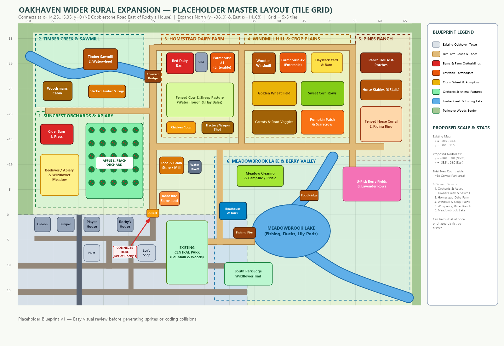

# Oakhaven Rural Northeast Expansion — Master Layout Reference

This document saves the approved wider-scope placeholder master blueprint for Oakhaven's rural countryside expansion connecting directly from the **NE Cobblestone Road east of Rocky's house** (`x = 14.25..15.35, y = 0`) and extending north (`y = -38..0`) and east (`x = 14..68`).

---

## Map Bounds & Engine Integration
- **Existing Exterior Bounds (`js/overworld.js`):** `EXT_MIN_COL = -26.5`, `EXT_COLS = 33.5`, `y = 0 .. 36.5`
- **Target Expanded Countryside Bounds:**
  - Extend northern boundary `EXT_MIN_ROW` from `0` to `-38.0`
  - Extend eastern boundary `EXT_COLS` from `33.5` to `68.0`
- **Connection Gateway (`x = 14.25..15.35, y = 0`):**
  - Cobblestone NE road north of Rocky's house passes beneath a rustic **"MEADOWBROOK"** arch at `y = 0` and transitions into sandy packed-dirt country lanes.

---

## Dirt Road & Trail Network

| Segment | Approximate Tile Coordinates | Role |
| :--- | :--- | :--- |
| **Main North Country Lane** | `x: 14.15..15.50, y: -33.7..0` | Primary north trunk road starting at the NE cobblestone connection (`y = 0`), passing Covered Bridge at `y ≈ -28.7..-26.3`. |
| **East Valley Country Road** | `x: 14.15..60.65, y: -14.2..-12.85` | Main east-west country road connecting the Crossroads (`y = -13.5`) across Dairy Farm, Crop Plains, and Whispering Pines Ranch. |
| **Orchard & Sawmill Spur (West)** | `x: -6.5..15.0, y: -21.2..-20.05` | Separates Timber Creek & Sawmill (north) from Suncrest Orchards & Apiary (south). |
| **Northern Ridge Farm Loop** | `x: 15.0..54.0, y: -33.8..-32.65` | Upper east-west lane framing Dairy Farm #1, Windmill Hill, Farmhouse #2, and Ranch. |
| **Center Farm N-S Lane** | `x: 31.8..33.0, y: -33.8..-13.2` | Vertical connector separating Homestead Dairy Farm from Windmill Hill & Crop Plains. |
| **East Ranch N-S Lane** | `x: 53.8..55.05, y: -33.8..-8.2` | Vertical road along the west edge of Whispering Pines Ranch and south toward Berry Fields. |
| **Lake & Park Trail Loop** | `x: 27.5..28.7, y: -13.0..6.0` + east/west spurs at `y = 4.8..5.95` | Leads south from East Valley Road down to Boathouse, Fishing Pier, and connects west (`x = 25.0..28.5`) toward Central Park's northeast edge. |

---

## District Reference Table

| # | District | Tile Bounds (`x`, `y`) | Landmarks, Buildings & Rural Features |
| :--- | :--- | :--- | :--- |
| **0** | **Gateway & Crossroads** | `x: 13.5..24.5, y: -14..0` | Wooden Gateway Arch (`y = 0`), **Roadside Farmstand**, **Feed & Grain Store / Mill**, and **Water Tower**. |
| **1** | **Suncrest Orchards & Apiary** | `x: -8.5..13.0, y: -20.5..-1.5` | **Apple & Peach Orchard** tree grid, **Cider Barn & Press**, cider barrels/crates, and **Beehives / Apiary & Wildflower Meadow**. |
| **2** | **Timber Creek & Sawmill** | `x: -8.5..13.0, y: -35.8..-21.4` | Winding **Timber Creek** flowing east under a **Covered Bridge**, waterwheel **Timber Sawmill**, **Woodsman's Cabin**, and stacked log piles. |
| **3** | **Homestead Dairy Farm** | `x: 16.5..32.0, y: -35.8..-15.4` | **Red Dairy Barn + Grain Silo**, **Farmhouse #1 (Enterable)**, fenced **Cow & Sheep Pasture** (water trough & hay bales), **Chicken Coop**, and **Tractor / Wagon Shed**. |
| **4** | **Windmill Hill & Crop Plains** | `x: 33.0..54.0, y: -35.8..-15.4` | **Wooden Windmill**, **Farmhouse #2 (Enterable)**, **Haystack Yard & Barn**, plus 4 plowed crop plots (**Golden Wheat**, **Sweet Corn**, **Carrots & Root Veggies**, **Pumpkin Patch & Scarecrow**). |
| **5** | **Whispering Pines Ranch** | `x: 55.0..65.8, y: -35.8..-10.7` | **Ranch House & Porches**, **6-Stall Horse Stables**, and fenced **Horse Corral & Riding Ring** backed by eastern pine woods. |
| **6** | **Meadowbrook Lake & Berry Valley** | `x: 27.0..65.8, y: -11.5..17.0` | **Meadowbrook Lake** (`x: 34.5..50.0, y: -2.0..8.5`) fed by an eastern creek, **Footbridge**, **Boathouse & Dock**, **Fishing Pier**, **Campfire / Picnic Meadow**, **U-Pick Berry & Lavender Fields**, and **South Park-Edge Wildflower Trail**. |
